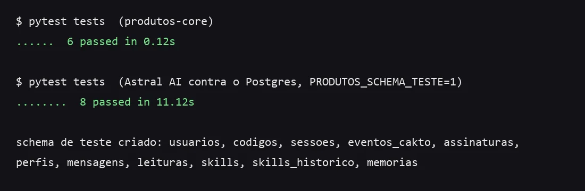

<!-- readme-padrao -->
# produtos-core

> Biblioteca compartilhada dos produtos da Rangel Tech (spec 57, seção 8.8). Hoje: o **banco Postgres compatível com o SQLite** dos produtos e a **ferramenta de migração**. Próximas versões: identidade, login (e-mail e senha, entrar por link, captcha invisível), admin padrão e armazenamento S3 (MinIO).



## O que é
Os 12 produtos escrevem SQL no dialeto do SQLite. `produtos_core.banco_pg.Banco` tem **a mesma interface** do `Banco` deles (`tx()`, `exec()`, `um()`, `todos()`, `con.execute()`), mas grava no **Postgres central** (banco `produtos`, **um schema por produto**), traduzindo o que é do SQLite: `?`, `INSERT OR IGNORE/REPLACE`, `strftime`, `MAX(a,b)` escalar, `LIKE` (sem diferenciar maiúsculas), `PRAGMA table_info`, `lastrowid`, `executescript` e os tipos do DDL. Erros de integridade continuam saindo como `sqlite3.IntegrityError` e cada comando dentro de transação roda num savepoint, como o produto espera.

Estado: **em uso** (piloto: Astral AI).

## Onde está no ar
É uma biblioteca: entra na imagem de cada produto pelo `requirements.txt` (versão fixa por tag, baixada como `.tar.gz` do GitHub).

## Onde faz o deploy
Não tem deploy próprio. Publicar uma versão: criar a tag (`v0.x.y`); cada produto sobe a versão no seu `requirements.txt`, gera a release dele e o `vps_rt_infra` implanta (`gh workflow run deploy.yml -f service=<produto>`).

## Como funciona por dentro
- `banco_pg.py`: o `Banco` compatível e o tradutor de SQL.
- `migrar.py`: copia um produto do SQLite para o schema dele (ids originais, sequências acertadas, contagem conferida por tabela; `--sem-testes` não leva usuários de QA automatizado).
- No produto, `app/db.py` usa o Postgres quando existe `PRODUTOS_DATABASE_URL` (e `PRODUTOS_SCHEMA`); sem ela, volta ao SQLite (plano de volta).

## Segredos
Nenhum. A URL do banco de cada produto fica no Infisical (`rt-produtos/<produto>`: `PRODUTOS_DATABASE_URL`).

## Rodar e testar localmente
```bash
pip install -e . pytest
pytest tests            # tradutor (sem banco)
```
Teste de verdade de cada produto: a bateria do próprio produto contra o Postgres (`PRODUTOS_DATABASE_URL=... PRODUTOS_SCHEMA_TESTE=1 pytest`), que cria um schema novo por teste.

## Links
- Spec: `new_ragente/specs/57_ORGANIZACAO_GERAL_PRODUTOS_E_PAINEL.md` (seções 8 e 8.8)
- Registro dos produtos: `vps_rt_infra/registro/produtos.yml`
